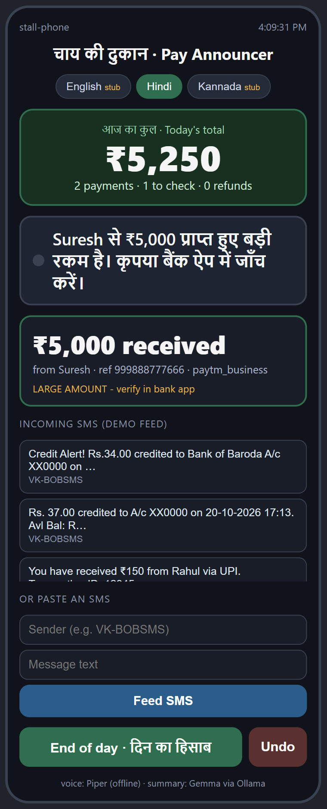
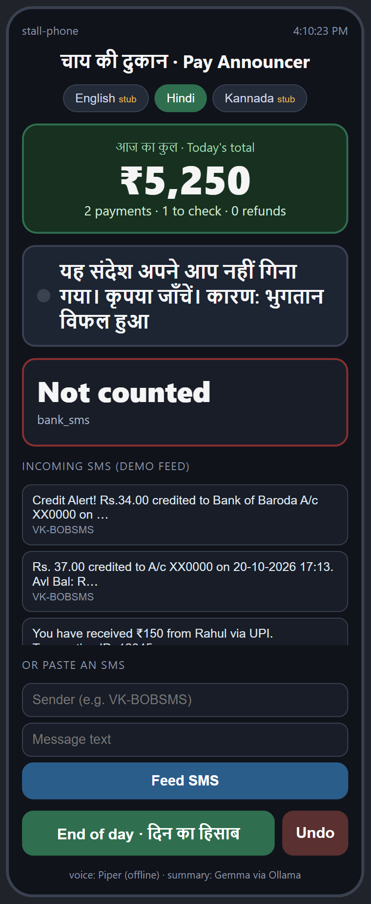

# Chai Stall Pay Announcer

An offline-first payment announcer for a small Indian tea stall. UPI and bank
SMS come in, the stall hears each payment spoken aloud in Hindi, and at closing
time it gets a short end-of-day summary plus the bills due next.

Built for the Week 3 Hacktoberfest project. Standard-library Python: no pip
install, no cloud, no account numbers or OTPs ever spoken.

## What it does

- **Parses real UPI/bank SMS** — credited, refunded, failed, debited, OTP and
  spoofed senders are classified separately. Amounts are handled in paise.
- **Deduplicates** repeats by reference id, or by amount + time when a bank SMS
  has no reference.
- **Flags** large payments and messages that need a human look.
- **Speaks Hindi offline** with [Piper](https://github.com/rhasspy/piper), and
  falls back to the OS voice (or plain text) if Piper is missing.
- **End-of-day summary** written by a local Gemma model through Ollama, with a
  deterministic Hindi template as the fallback.

## Try it

```bash
python app.py demo          # 16 sample SMS, 8 counted, spoken aloud
python app.py serve         # phone-frame UI on http://localhost:8000
python test_suite.py        # 41 unit tests, no network needed
```

The web page has sample messages to click and a box to paste any SMS. In real
use the same parser is fed by `python app.py watch`, which reads SMS from stdin
(what an SMS forwarder would pipe in).

## Screenshots





## Setup

- Python 3.10 or newer. Nothing to install.
- Optional Hindi voice: Piper + `hi_IN-pratham-medium.onnx` in `piper/` and
  `voices/`. Not committed here (60 MB of binaries).
- Optional summary: Ollama with `gemma3:4b`.

```bash
ollama pull gemma3:4b
```

Config lives in `config.json`. `num_gpu` is set to `0` and `keep_alive` to
`30m` for a small laptop: forcing CPU avoids a slow partial GPU offload, and
the long keep-alive stops the model unloading between demo takes. Set
`num_gpu` to `null` to let Ollama decide.

## The summary cannot lie about money

Small local models drift. In testing, `gemma3:4b` once said "5,717" for a
5,716 total, and once ignored the facts entirely. So the model output is only
used if:

1. every rupee amount matches the ledger, and
2. the exact total appears **in digits**, and
3. no English wrapper text, pronunciation notes or questions survive.

Otherwise the deterministic template is spoken. The bills line always comes
from `bills.json`, never from the model.

## Known limits

- `gemma4:latest` (7.5B) needs a ~6 GB buffer and fails with an out-of-memory
  error on a 16 GB laptop with ~5.5 GB free. The demo uses `gemma3:4b`
  (4.3B, ~2.9 GB) on CPU.
- A summary takes about 40 seconds on CPU. The UI shows a waiting state; the
  model is kept warm between calls.
- Only Hindi has a full voice pack. English and Kannada are marked stubs and
  use templates.
- The web page is a simulator for the demo; the real input path is
  `app.py watch` fed by an SMS forwarder.

## Android port (v0.2 code-complete)

The parser, ledger rules, Room storage, notification listener, Hindi TTS,
template summary, `foss` SMS flavor and watchdog are in Kotlin across `:core`,
`:ledger`, `:storage` and `:app`, with 71 tests. The suite includes the same
16-message corpus and ₹5,716 total as the Python demo, Room persistence and
cross-source dedupe, and Hindi text tests. Signed `play` and `foss` release APKs
build locally. The app has not been tested on a physical phone here; the
notification/SMS field test and reboot soak remain the gate. The optional
on-device summary model is not included. The Python app remains the reference
implementation.

See [android/README.md](android/README.md) for the module, test and APK commands,
[docs/install.md](docs/install.md) for installation, and
[docs/privacy.md](docs/privacy.md) for the data note.

## Files

| File | Purpose |
|---|---|
| `sms_parser.py` | SMS classification, amounts, dedupe keys |
| `ledger.py` | JSONL ledger + daily stats |
| `announcer.py` | Piper / OS voice, speech sanitising |
| `summarizer.py` | Gemma prompt, guards, templates |
| `server.py` | HTTP API + demo state + speech queue |
| `index.html` | phone-frame demo UI |
| `app.py` | `demo`, `ingest`, `watch`, `serve`, `summary`, `undo` |
| `lang_hi.json` | Hindi templates and voice config |
| `test_suite.py` | 41 tests |
| `android/` | Kotlin parser + ledger + Room storage + notification/SMS app (`:core`, `:ledger`, `:storage`, `:app`; 71 tests) |
| `docs/android-roadmap.md` | Plan and status for the on-phone app |
| `docs/install.md` | Sideload and permission guide |
| `docs/privacy.md` | What the Android app reads and stores |

`README.txt` keeps the original plain-text walkthrough, including the full
Windows/Piper setup and the verification checklist.
